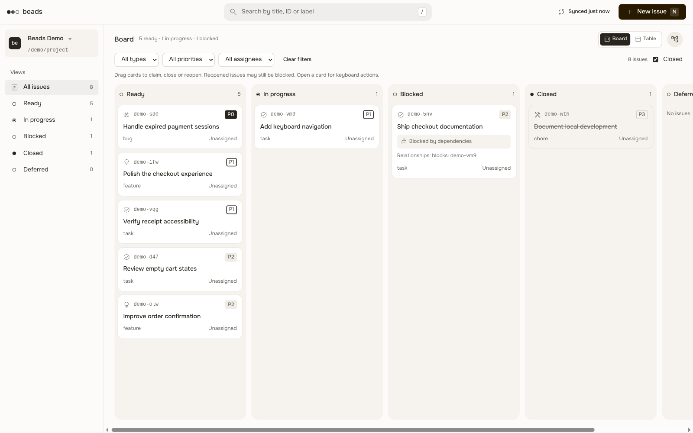
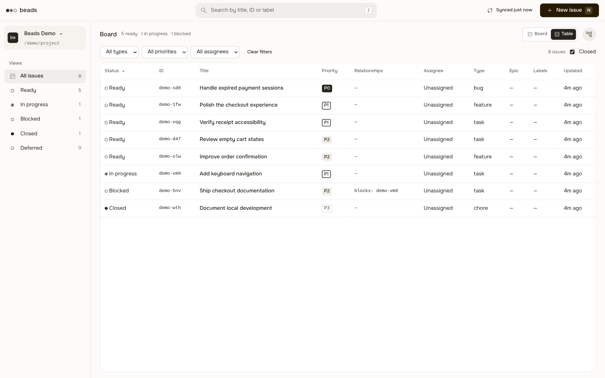
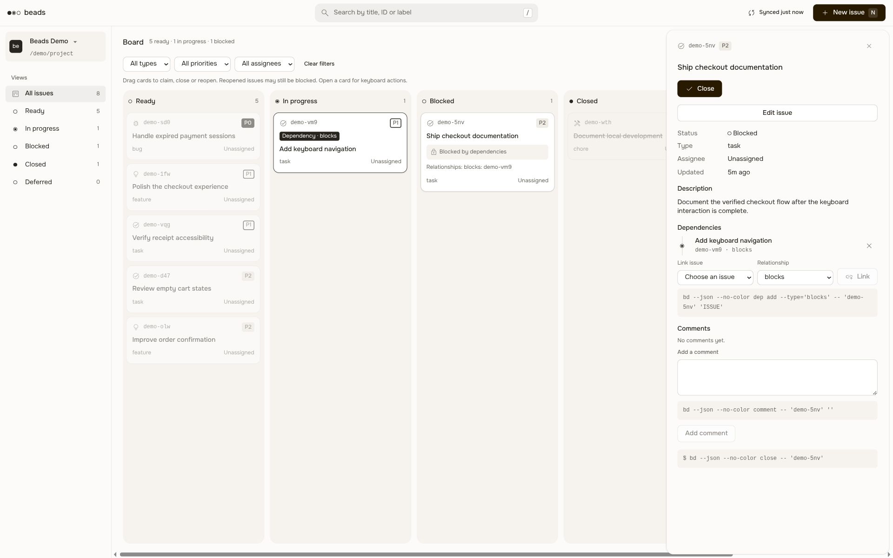

# Beads Board for Orca

**Your Beads board, inside Orca.** See what is ready, follow dependencies, and update issues without leaving your workspace. Beads remains the source of truth; the panel works with your existing `bd` CLI and project.

[Русский](README.ru.md)



*Screenshots show the actual plugin panel in a headless browser, backed by an isolated Beads demo project. Tasks are synthetic and the displayed project path is sanitized; these are not screenshots of the Orca window.*

## Install

Install the native plugin directly from Git; no source build or development link is needed. Community-catalog discovery is separate and may require review.

In Orca, open **Settings → Plugins → Add plugin → From Git URL** and enter:

```text
https://github.com/Roflochinsky/beads-orca#v0.1.2
```

Alternatively, use the [Orca community catalog](https://onorca.dev/plugins/roflochinsky.beads?catalog=community) once listed. Check the [listing status](https://www.onorca.dev/plugins/roflochinsky/beads-orca) if it is not available there; Git installation does not require a community listing.

You will need:

- Orca **1.4.248 or newer**.
- Beads CLI **1.3.2** on the Orca process's `PATH`, and an already initialized local Beads project.

Review the publisher and access request during installation, approve only if you trust the plugin, and open the **Beads Board** panel in Orca. Local Orca workspaces are listed automatically. To add another local project, use **Additional local Beads project paths** in the plugin settings, one absolute project path per line.

> **Trust matters.** This is a trusted worker, not a sandboxed panel. It runs with the full access of your user account and invokes the local `bd` CLI to read and change tasks. Install it only if you trust the plugin and the selected projects. Review the requested Orca capabilities before approval.

## Work with your tasks

- **Find the next issue.** Switch between board and sortable table, search by title, ID, description, assignee or label, and filter by view, type, priority and assignee.
- **Understand dependencies.** See relationships in the board and issue details; highlight a task's blockers and dependents. Ready and blocked membership comes from Beads, not a separate rules engine.
- **Keep work moving.** Create and edit issues, manage dependencies and comments, and Claim, Close or Reopen from the panel. Closing offers a guarded Undo: it reopens only if the issue has not changed since it was closed.

| Table | Issue details |
| --- | --- |
| [](docs/images/table.png) | [](docs/images/detail.png) |

## Current limits

The plugin operates on **local** projects through the locally installed `bd`. It does not read or modify a remote workspace's Beads database, launch agents, hand tasks to agents, or close tasks based on agent session state. It adds its own panel; it does not replace Orca's built-in Tasks.

Project configuration and routing are trusted. In Beads 1.3.2, the local-ID precheck and a subsequent write are not atomic: an external deletion between them can allow native prefix routing to another configured store. This plugin is not a database sandbox. See the [adapter contract](src/core/README.md) for details.

This repository is for Orca only. For Tern, see [beads-tern](https://github.com/Roflochinsky/beads-tern); for other hosts and the original browser HUD, see [beads-hud](https://github.com/Roflochinsky/beads-hud) and its [native integrations](https://github.com/Roflochinsky/beads-hud/tree/main/native).

## Approved roadmap

These are **planned, not implemented**; no release dates are promised. The approved Q1–Q24 scope includes selecting tasks and previewing explicit handoffs to existing or new CLI agent sessions; blocker and Claim awareness; linked Markdown context; remote-host support; saved filters; personal handoff history; worktree guidance; and human review of results. Sending work will not itself mean an agent accepted it or a Beads task is complete.

See the [detailed product scope](docs/product-scope.md) and [integration constraints](docs/integration-constraints.md).

## Development

From the repository root, with Node.js **24 or newer** and `bd` 1.3.2 installed:

```sh
npm ci
npm run typecheck
npm run build
npm test
npm run smoke
npm run package:plugins
```

The build produces `dist/orca`. The smoke uses a disposable Beads project and the built worker, not the real Orca UI. See [verification](docs/verification.md) for recorded evidence and limits.

For a local development load, inspect the request and follow the exact approval command returned by Orca:

```sh
orca-ide plugin validate ./dist/orca --json
orca-ide plugin dev load ./dist/orca --json
orca-ide plugin open local.beads --panel beads --json
```

On Linux outside an Orca terminal, use `orca-ide`: bare `orca` can refer to the system screen reader. The `local.beads` identity is for a development load, not the community catalog identity.

## License

[MIT](LICENSE). Third-party UI assets retain their own licenses; see the [asset notices](src/ui/THIRD-PARTY.md).
