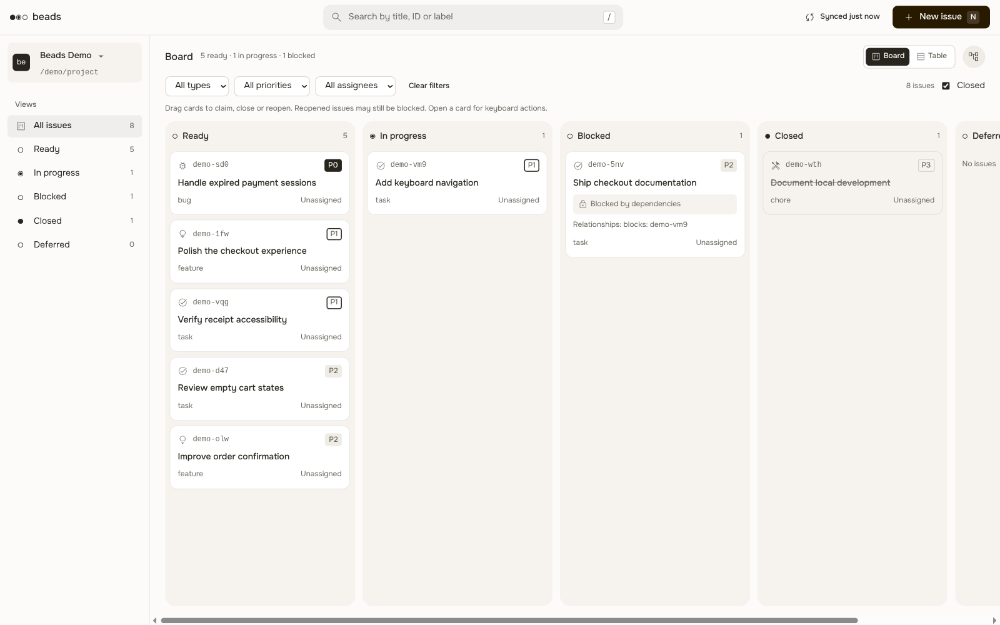
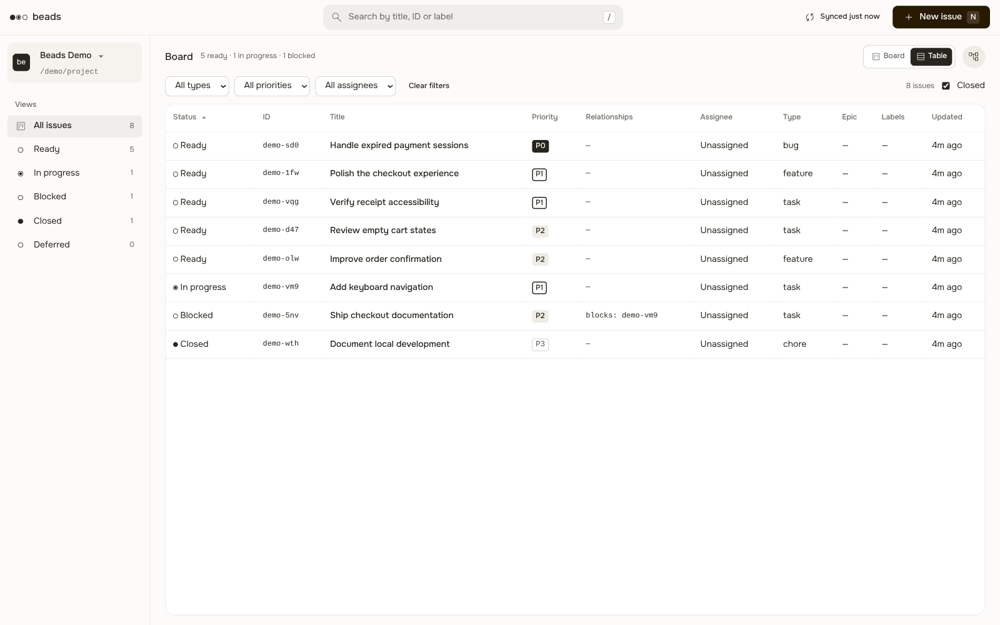
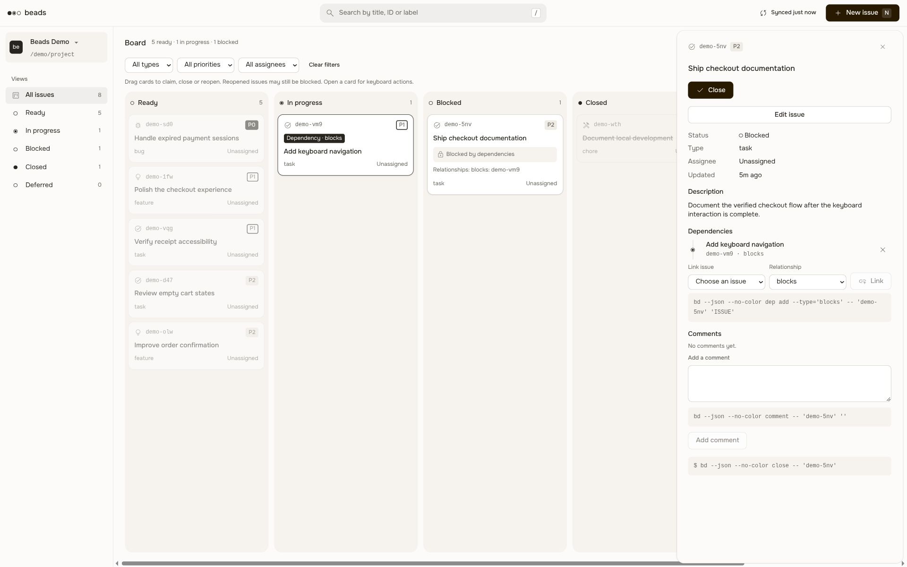

# Beads Board для Orca

**Ваша доска Beads — внутри Orca.** Находите готовые задачи, разбирайтесь в зависимостях и обновляйте их, не покидая рабочее пространство. Источником данных остаётся Beads: панель работает с установленным `bd` и существующим проектом.

[English](README.md)



*На скриншотах — настоящая панель плагина в headless-браузере с изолированным демонстрационным проектом Beads. Задачи синтетические, отображаемый путь обезличен; это не скриншоты окна Orca.*

## Установка стабильного выпуска

Текущий выпуск — **v0.2.0**. Установите нативный плагин напрямую из Git: сборка исходников и dev link не нужны. Передача существующей сессии отключена; выпуск не означает полную приёмку Q1–Q24. Появление в каталоге сообщества — отдельный процесс, который может потребовать проверки.

В Orca откройте **Настройки → Плагины → Добавить плагин → По URL Git…** и укажите:

```text
https://github.com/Roflochinsky/beads-orca#v0.2.0
```

Другой вариант — [каталог сообщества Orca](https://onorca.dev/plugins/roflochinsky.beads?catalog=community), когда плагин в нём появится. Проверить [статус листинга](https://www.onorca.dev/plugins/roflochinsky/beads-orca) можно отдельно; установка из Git не зависит от листинга.

Требования:

- Orca версии **1.4.250 или новее**.
- Beads CLI **1.3.2** на хосте исполнения и инициализированный проект Beads.
- POSIX и `python3` для документов и артефактов; системный SSH и явная настройка для удалённых хостов.

При установке проверьте издателя и запрошенный доступ, подтвердите его только при доверии к плагину и откройте панель **Beads Board** в Orca. Локальные рабочие пространства Orca добавляются автоматически. Другие локальные проекты можно указать в настройке **Additional local Beads project paths** — по одному абсолютному пути к проекту в строке.

> **Доверяйте плагину осознанно.** Это trusted worker, а не изолированная песочница. Он запускается с полным доступом вашей учётной записи и вызывает локальный `bd` для чтения и изменения задач. Устанавливайте его, только если доверяете плагину и выбранным проектам. Перед подтверждением проверьте запрошенные разрешения Orca.

## Работа с задачами (стабильный выпуск)

- **Находите следующую задачу.** Переключайтесь между доской и сортируемой таблицей, ищите по названию, ID, описанию, исполнителю или метке и фильтруйте по представлению, типу, приоритету и исполнителю.
- **Понимайте зависимости.** Просматривайте связи на доске и в карточке задачи; подсвечивайте блокеры и зависимые задачи. Готовность и блокировка берутся из Beads, а не из отдельного механизма правил.
- **Продвигайте работу.** Создавайте и редактируйте задачи, управляйте зависимостями и комментариями, выполняйте Claim, Close и Reopen из панели. После Close доступен защищённый Undo: он переоткрывает задачу, только если она не изменилась после закрытия.

| Таблица | Карточка задачи |
| --- | --- |
| [](docs/images/table.png) | [](docs/images/detail.png) |

## Ограничения стабильного выпуска

Плагин добавляет панель, а не заменяет Tasks Orca. Передача существующей сессии отключена до появления атомарной idle-only отправки в Orca. Передача новой сессии не выполняет Claim и не закрывает задачу автоматически. Удалённый доступ требует явного SSH-сопоставления; база Beads и целевой workspace должны находиться на одном хосте исполнения.

Конфигурация проекта и маршрутизация считаются доверенными. В Beads 1.3.2 проверка локального ID и последующая запись не атомарны: если внешний процесс удалит задачу между ними, штатная маршрутизация по префиксу может обратиться к другому настроенному хранилищу. Плагин не изолирует базы. Подробности — в [контракте адаптера](src/core/README.md).

Этот репозиторий предназначен только для Orca. Плагин для Tern находится в [beads-tern](https://github.com/Roflochinsky/beads-tern), другие хосты и исходный браузерный HUD — в [beads-hud](https://github.com/Roflochinsky/beads-hud) и его [native-интеграциях](https://github.com/Roflochinsky/beads-hud/tree/main/native).

## Сценарии версии 0.2.0

В выпуске реализованы следующие части согласованного scope; реализация и полная приёмка учитываются отдельно:

- **Явные поручения:** выбор задач разных проектов, группы с исходной базой и целевым workspace, предпросмотр блокеров и явно выбранного Markdown-контекста целиком или по строкам, режим реализации или исследования. Изменённый контекст отклоняет Send с пояснением и требует нового предпросмотра. Запуск новой CLI-сессии использует квитанции Orca; отправка не означает Claim, принятие или завершение работы.
- **Несколько хостов:** локальные и явно настроенные SSH-проекты, доступность хостов и offline-снимки с исходным временем получения. База Beads и целевой workspace должны находиться на одном хосте исполнения. Paired-хосты без SSH-сопоставления видимы, но не поддерживаются.
- **Контекст и проверка:** чтение/открытие Markdown, личные фильтры и явная публикация проектных, личная история с экспортом/импортом/удалением, предпросмотр/создание native worktree, отчёты по каждой задаче и явная очистка артефактов. Нет автоматических повторных отправок, Close, merge, push или удаления worktree.

**Передача существующей сессии заблокирована:** в Orca нет атомарного native idle-only gate перед отправкой. Найденные сессии недоступны для Send. Это не снятый блокер приёмки Q1–Q24, а не готовая возможность.

Для разработки нужны Orca **1.4.250+**, Node **24+** и `bd` **1.3.2** на хосте исполнения. Файловые операции требуют POSIX и `python3`; удалённый доступ — системного SSH и явной настройки `remoteHosts`. См. [настройку и границы доверия](docs/integration-constraints.md), включая ограничение стандартного native-профиля, гонку открытия редактора и содержимое SSH config.

**65 тестов**, smoke с настоящим `bd` и проверки пакета прошли в [CI на Ubuntu и macOS](https://github.com/Roflochinsky/beads-orca/actions/runs/42369795828). На Linux также проверены native-панель, изолированный SSH/offline и публичная Git-установка. **Работа настоящей модели, native UI Orca на macOS и реальный paired runtime не проверены.** Обнаружение провайдера не доказывает авторизацию; импортированная история и отчёты требуют человеческой проверки.

Подробнее: [матрица реализации/приёмки и сохранённые решения](docs/product-scope.md), [контракт workflow](docs/workflow.md), [свидетельства проверок](docs/verification.md).

[Предпросмотр поручения в native Orca](docs/images/native-handoff-unreleased.png). Настоящий снимок 1301×900 с синтетическими задачами и реализацией выпуска без тестового launch adapter; запуск агента не показан.

## Разработка

В корне репозитория, с Node.js **24 или новее** и установленным `bd` 1.3.2:

```sh
npm ci
npm run typecheck
npm run build
npm test
npm run smoke
npm run package:plugins
```

Результат сборки — `dist/orca`. Smoke использует одноразовый проект Beads и собранный worker, а не интерфейс реальной Orca. Подтверждённые проверки и их границы описаны в [verification](docs/verification.md).

Для локальной загрузки в режиме разработки проверьте запрос и выполните точную команду подтверждения, которую вернёт Orca:

```sh
orca-ide plugin validate ./dist/orca --json
orca-ide plugin dev load ./dist/orca --json
orca-ide plugin open local.beads --panel beads --json
```

В Linux вне терминала Orca используйте `orca-ide`: команда `orca` может означать системный экранный диктор. Identity `local.beads` относится к загрузке для разработки, а не к каталогу сообщества.

## Лицензия

[MIT](LICENSE). Для сторонних ресурсов интерфейса сохраняются их собственные лицензии; см. [уведомления об активах](src/ui/THIRD-PARTY.md).
